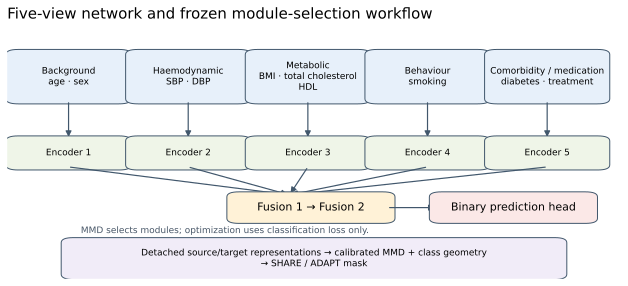
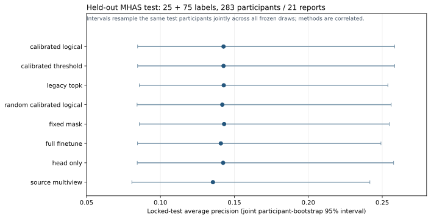

# Selective Multiview Transfer Learning for Cardiovascular Outcome Prediction

**Research code and aggregate results.** Phase 1 is a closed HAALSI (South Africa) → MHAS (Mexico) study. Phase 2 is a separate HRS → ELSA feasibility investigation; **no Phase-2 model has been trained**. This repository contains no participant data, private test assignments, fitted real-data preprocessing or real-data checkpoints.

## Research question

Can a model pretrained in one population adapt effectively with few labeled people in another, and can it decide which representations to update? Cross-population transfer is difficult when measurements, disease reporting, participant mix and follow-up differ. A small target-label budget also makes module-level evidence uncertain. Phase 1 tested a **re-engineered DMV-MAT-style** module-selection principle inspired by [Cui et al., *Deep Multiview Module Adaption Transfer Network for Subject-Specific EEG Recognition*](https://doi.org/10.1109/TNNLS.2024.3350085). The clinical views, statistics and decision rules here are **not an exact reproduction** of that EEG paper, nor a demonstrated new algorithmic advance.

## Phase 1 design

HAALSI Wave 1 supplied source training; MHAS's 2012 examination cohort supplied target adaptation, validation and one immutable held-out test. The endpoint was a **wave-observed, doctor-reported heart attack or stroke**, conditional on observed follow-up. It is not adjudicated cardiovascular incidence, a precisely dated first event or validated individual clinical risk. The actual cohort derivations and private split cannot be reproduced from this code release.

| Clinical view | Baseline predictors in the completed public-cohort study |
|---|---|
| Background | Age, baseline sex |
| Haemodynamic | Systolic and diastolic blood pressure |
| Metabolic | BMI, total cholesterol, HDL cholesterol |
| Behaviour | Smoking status |
| Comorbidity and medication | Doctor-reported diabetes, antihypertensive treatment |

The PyTorch model has five view-specific encoders, two fusion modules and a binary prediction head. Detached intermediate representations inform a selector using source/target **maximum mean discrepancy (MMD)** and source-relative class geometry. A module marked **SHARE** remains frozen; an **ADAPT** module and the prediction head can update on target adaptation labels. MMD is a **module-selection statistic**, never an added training loss. The repository retains `legacy_topk`, `calibrated_threshold` and `calibrated_logical` implementations and synthetic controls. Details and the real-data release boundary are in [Phase 1 method and reproducibility](docs/PHASE1_METHOD_AND_REPRODUCIBILITY.md).



## Closed Phase 1 result

The locked MHAS test contained **283 people, including 21 positive reports**. Across ten paired 25-positive/75-negative adaptation draws on that same test population:

| Registered quantity | Held-out aggregate |
|---|---:|
| Calibrated logical AP | 0.1427 |
| Full fine-tuning AP | 0.1408 |
| Calibrated logical AUROC | 0.7029 |
| Calibrated logical Brier score | 0.0677 |
| **Primary paired AP difference, logical − full** | **+0.00182** |
| Descriptive 95% joint participant-bootstrap interval | **−0.02481 to +0.03234** |

**Selective-adaptation superiority was not established.** The logical selector adapted no additional view or fusion module in **9/10 primary draws**, so its small trainable-parameter fraction largely reflects head-only behavior. Head-only fine-tuning was competitive. A parameter-matched random mask exactly matched the logical mask in **9/10 primary** and **10/10 low-label** draws because the feasible mask set often collapsed to one choice. These are observations; the causes of the predictive results are not established. Only 13 validation and 21 test positive reports were available, and the deliberately enriched adaptation samples had a 25% positive fraction, complicating uncertainty and probability calibration. Some prespecified sensitivities were not performed.



See the [manuscript draft](docs/FINAL_SUBMISSION_MANUSCRIPT.md), [aggregate supplement](docs/SUPPLEMENTARY_AGGREGATE_RESULTS.md), [machine-readable aggregate result](results/aggregate_only_results.json), and [seven aggregate-only figures](figures/). The manuscript remains **subject to author approval**; the MHAS product-specific citation and other disclosure items remain open.

## Phase 2: research in progress

[Phase 2A](phase2/PHASE2A_RESEARCH_FEASIBILITY_REPORT.md) examined a new **HRS → ELSA** source/target design, candidate methods and official access/documentation. Its conclusion was **NO-GO for immediate model training**: exact common endpoint semantics, eligible incident-event counts and external-validation precision are not established. HRS public-data registration and additional sensitive-product requirements are documented; this project has not confirmed individual HRS account access. ELSA participant-data acquisition and field-level verification remain pending. CHARLS and SHARE have potentially incompatible compound heart-condition questions. No Phase-2 performance estimate exists.

The preferred *hypothesis* is uncertainty-aware, view-specific source shrinkage in a compact tabular model, evaluated against regularized logistic regression, boosting, model updating and neural transfer controls. It is not claimed novel or effective. See [dataset comparison](phase2/PHASE2A_DATASET_COMPARISON.md), [prior art](phase2/PHASE2A_LITERATURE_AND_NOVELTY_REVIEW.md), [candidate methods](phase2/PHASE2A_NEW_METHOD_CANDIDATES.md) and [proposed protocol](phase2/PHASE2A_RECOMMENDED_EXPERIMENTAL_PROTOCOL.md).

## Reproduce synthetic-only behavior

Use Python **3.10+** in a fresh environment. The optional XGBoost extra is not needed for the core smoke test.

```bash
python3 -m venv .venv
source .venv/bin/activate
python -m pip install -e . -r requirements-dev.txt
pytest -q
python -m dmv_mat_cvd.experiment --config configs/synthetic_smoke.json --source-n 320 --target-n 160 --device cpu
```

The example writes new **synthetic** run artifacts beneath ignored `results/runs/`. The tests in this release use invented data; the original controlled-data and final-test executors are excluded. Synthetic selector experiments can be started with `python -m dmv_mat_cvd.experiments.selector_validation` after reading that module's CLI help and choosing a bounded development grid. Synthetic results validate code and method behavior only, **not clinical prediction**.

## Study and release limits

- The released source uses a generic/synthetic schema with a historical fasting-glucose slot; the completed HAALSI/MHAS study used a separately versioned doctor-reported diabetes feature. **Do not treat the synthetic CLI as a complete real-cohort reproduction.**
- Raw cohort files, crosswalks with release-specific details, private test assignments, adaptation IDs, individual predictions, saved real-data models and fitted preprocessors are absent. Obtain data through [ICPSR HAALSI](https://www.icpsr.umich.edu/web/NACDA/studies/36633) and [official MHAS](https://www.mhasweb.org/DataProducts/Home.aspx) under their terms; do not upload them to GitHub.
- The first authorized final-test attempt accessed test rows and failed before producing predictions or metrics. A **separately authorized, runtime-only recovery** evaluated the same frozen test. [Reproducibility documentation](docs/PHASE1_METHOD_AND_REPRODUCIBILITY.md) discloses the incident. No further original test access is authorized.
- This is a research and reproducibility artifact, not a clinical tool or deployment validation. No code license has been granted in this repository; license selection and public-release review require explicit author approval.

## Citation and acknowledgments

Cite the original [DMV-MAT EEG paper](https://doi.org/10.1109/TNNLS.2024.3350085) for inspiration, the [HAALSI study and ICPSR V4 release](https://www.icpsr.umich.edu/web/NACDA/studies/36633), and the [MHAS official data products](https://www.mhasweb.org/DataProducts/Home.aspx) for any authorized reuse. Exact MHAS product names, release years and retrieval dates must be checked against the user's original download record before a manuscript is submitted. Follow each distributor's citation, confidentiality, non-reidentification, transfer and research-product-notification terms. This repository does not claim that required MHAS notification or final author sign-off has occurred.
