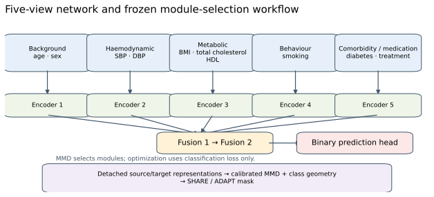
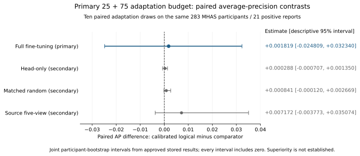

# Selective Multiview Transfer Learning for Cardiovascular Outcome Prediction

Research code and approved aggregates for a closed **HAALSI (South Africa) → MHAS (Mexico)** experiment. A five-view neural network tests whether selectively updating pretrained representations helps when target labels are scarce. The primary comparison was **inconclusive**; this repository preserves that result and its limitations.

The implementation is inspired by [Cui et al.'s EEG DMV-MAT](https://doi.org/10.1109/TNNLS.2024.3350085). It re-engineers clinical views and module-selection rules for survey data; it is not an exact reproduction or a demonstrated new algorithm. This is a research artifact, not a clinically validated prediction tool.

## Original implementation and complete public artifact packages

The [research archive](research/README.md) now includes **13 original experiment/tool packages**, the historical Phase 1 implementation snapshot, and the original three retained **invented-data** threshold runs (300 matrix SVGs) with per-draw/summary metrics and SVG/PNG plots. These are actual source/output files, preserved and hash-checked, rather than documentation-only descriptions. They are not the protected real MHAS confusion collection. 16 historical source files explicitly project private bindings/paths; the remaining archived code retains original bytes. Academic reports, LaTeX and bibliographies are excluded by author instruction.

```sh
python scripts/verify_imported_artifacts.py
python scripts/run_imported_tests.py
```

## Explore the research portfolio

| Review question | Entry point |
|---|---|
| What figures and results can I inspect? | [Scientific results gallery](docs/PHASE1_RESULTS_GALLERY.md) |
| What exists, and what remains unpublished? | [Complete artifact inventory](docs/PHASE1_COMPLETE_ARTIFACT_INVENTORY.md) |
| What did we develop and what did it show? | [Phase 1 supervisor guide](docs/SUPERVISOR_PHASE1_GUIDE.md) |
| Where is the academic B.Tech PDF? | [Report publication status](reports/nitw-btech-phase1/README.md): PDF/LaTeX staged locally; separate authorship/identifier/form/public-distribution approval pending |
| How does the report map to implementation? | [Exact report-to-code map and gaps](docs/PHASE1_REPORT_TO_CODE_MAP.md) |
| Which figures are approved, empirical or synthetic? | [Figure inventory](docs/PHASE1_FIGURE_INVENTORY.md) and [paired AP contrasts](figures/08_primary_paired_ap_contrasts.svg) |
| What is the scientific method? | [Phase 1 overview](docs/phase1/overview.md), [frozen manuscript](docs/FINAL_SUBMISSION_MANUSCRIPT.md) |
| Where are all original results? | [Complete supplement](docs/SUPPLEMENTARY_AGGREGATE_RESULTS.md), [approved JSON](results/aggregate_only_results.json) |
| What can I run? | [Public source](src/dmv_mat_cvd), [reproduction instructions](docs/phase1/reproducibility.md), [tests](tests), [CI](.github/workflows/public-checks.yml) |
| What remains restricted? | [Threshold methodology/disclosure](docs/phase1/threshold-analysis.md) and [access requirements](docs/phase1/data-access-and-disclosure.md) |
| Has Phase 2 produced a real model? | [HRS → ELSA status](phase2/STATUS_20261107.md): no real training/performance result established |

Public synthetic checks and approved-aggregate figures are reproducible. Historical cohort/baseline/selective code and the joint-bootstrap implementation are now archived as reference source; controlled datasets, original private bindings, exact memberships and fitted models are not distributed; this is **not a one-command reconstruction of the private empirical experiment**. Academic-report and unreleased threshold publication require separate review; passing software checks does not establish institutional approval.

## Research status

| Workstream | Status |
|---|---|
| Phase 1 registered HAALSI → MHAS comparison | Closed; approved aggregate results available |
| Supplementary threshold software | Public methods, synthetic example and tests |
| Empirical threshold calculation / integrity | Completed privately, operator-reported; not inspected here |
| New empirical threshold publication | Pending disclosure review; no new cells or figures released |
| HRS → ELSA | Synthetic engineering implemented; scientific eligibility unresolved; no real training |

## Research question and architecture

Can a pretrained multiview model adapt across populations with relatively few target labels while controlling which representations update?



Five view-specific encoders feed two fusion blocks and a binary head. Detached source/target representations provide **MMD and source-relative class geometry** for seven independent SHARE/ADAPT decisions. SHARE freezes parameters; ADAPT permits updates; the head updates during adaptation. **MMD selects modules; it is not an added training loss.** The public code retains `legacy_topk`, `calibrated_threshold` and the primary `calibrated_logical` policy. See [equations, pseudocode and implementation references](docs/phase1/model-architecture.md).

## Dataset and protocol

The endpoint is **wave-observed, doctor-reported heart attack or stroke, conditional on observed follow-up**, among baseline-negative participants. It is not adjudicated incidence or an exact event date.

| Clinical view | Completed study's baseline predictors |
|---|---|
| Background | Age, sex |
| Haemodynamic | Systolic and diastolic blood pressure |
| Metabolic | BMI, total cholesterol, HDL cholesterol |
| Behaviour | Smoking status |
| Comorbidity/medication | Doctor-reported diabetes, antihypertensive treatment |

Source train/validation/held-out roles and target adaptation/validation/test roles were fixed. Ten paired adaptation draws used **25 positive + 75 negative** labels, with a secondary **10 + 30** budget. They share one 283-person test population with 21 positive reports. **Ten draws are not ten-fold cross-validation or ten independent tests.** Target validation adds 171 labeled participants with 13 positives. [Dataset counts and endpoint rules](docs/phase1/dataset-and-endpoint.md) and [the experimental protocol](docs/phase1/experimental-protocol.md) explain label accounting and uncertainty.

## Frozen Phase 1 findings

| Method, primary budget | AP | AUROC | Brier |
|---|---:|---:|---:|
| Source-only five-view network | 0.135493 | 0.688659 | 0.069207 |
| Head-only fine-tuning | 0.142376 | 0.702490 | 0.067665 |
| Full fine-tuning | 0.140845 | 0.685714 | 0.067472 |
| Calibrated logical, prespecified primary | 0.142664 | 0.702854 | 0.067654 |

The primary paired logical-minus-full AP difference is **+0.001819**, descriptive 95% joint participant-bootstrap interval **−0.024809 to +0.032340**. **Statistically established superiority was not demonstrated.** Head-only tuning was competitive. Logical adapted no internal module in 9/10 primary draws; parameter-matched random masks matched logical in 9/10 primary and 10/10 secondary draws, limiting that control.

[All 13 baselines and parameter fractions](docs/phase1/baselines-and-results.md) · [Frozen supplement](docs/SUPPLEMENTARY_AGGREGATE_RESULTS.md) · [Approved aggregate JSON](results/aggregate_only_results.json) · [Manuscript draft](docs/FINAL_SUBMISSION_MANUSCRIPT.md)



The [results gallery](docs/PHASE1_RESULTS_GALLERY.md) puts the cohort, architecture, validation, all-13 AUROC, two-budget AP, parameter economy and module-selection figures in scientific context. [The complete artifact inventory](docs/PHASE1_COMPLETE_ARTIFACT_INVENTORY.md) distinguishes implemented code, approved aggregates, synthetic demonstrations, restricted derivatives and unavailable clinical execution artifacts.

## Classification operating points

The supplementary analysis describes fixed probability cutoffs **0.05 through 0.50**, in steps of 0.05, on unchanged retained scores. TP/TN/FP/FN, accuracy, precision, recall, specificity, F1 and balanced accuracy change with cutoff; AP, AUROC and Brier do not. Undefined precision remains N/A. A conventional 0.50 cutoff is not a proven optimal rule; a **0.05 probability cutoff is unrelated to selector p ≤ 0.05**.

The independent operator reports private calculation completion and integrity verification. **No new empirical threshold tables, confusion figures or sensitive small cells are published in this update.** The sweep is retrospective descriptive analysis of an already examined test, not validated test-based optimization. `ORIGINAL_VALIDATION_OPTIMAL_THRESHOLD_NOT_ESTABLISHED` remains explicit. [Threshold methodology and formulas](docs/phase1/threshold-analysis.md) and [empirical publication status](docs/phase1/threshold-publication-status.md) explain the public software and its limits.

## Reproduce public synthetic behavior

Use Python 3.10+ in a fresh environment:

```sh
python3 -m venv .venv
source .venv/bin/activate
python -m pip install -e . -r requirements-dev.txt
python -m pytest -q
python -m dmv_mat_cvd.experiment --config configs/synthetic_smoke.json --source-n 320 --target-n 160 --device cpu
python examples/threshold_demo.py --output results/runs/threshold-demo-UNUSED
python scripts/check_public_release.py
python scripts/check_result_consistency.py
```

These commands require no controlled data. The last demonstration generates invented probabilities internally; it cannot ingest clinical files. Generated artifacts stay ignored. [Reproducibility instructions](docs/phase1/reproducibility.md) distinguish software checks from unavailable historical real-data reconstruction. The generic synthetic schema's historical fasting-glucose slot differs from the real-study diabetes feature; the synthetic CLI is not a complete clinical replication.

## Repository guide

| Location | Purpose |
|---|---|
| [docs/phase1](docs/phase1/overview.md) | Navigable scientific and engineering documentation |
| [docs](docs/PHASE1_METHOD_AND_REPRODUCIBILITY.md) | Preserved manuscript, supplement and historical release review |
| [src/dmv_mat_cvd](src/dmv_mat_cvd) | Models, selector, synthetic framework and portable threshold arithmetic |
| [tests](tests), [configs](configs), [examples](examples/README.md) | Invented fixtures and runnable public checks |
| [figures](figures) | Seven original approved figures, three approved-aggregate comparison figures and one labeled synthetic illustration |
| [phase2](phase2/STATUS_20261107.md) | Dated update and unchanged historical feasibility documents |
| [results](results/aggregate_only_results.json) | Approved ranking aggregates and historical synthetic benchmarks |

## Phase 2: HRS → ELSA

ELSA registration, a real interview-status diagnostic and a protected review worksheet have progressed in the independent environment, as reported by the operator. Public training infrastructure has passed synthetic tests in the separate research workspace. **Eligibility interpretation is unresolved, valid real event counts are unavailable, mappings are partial, and real HRS → ELSA training has not occurred.** Engineering readiness does not establish scientific clearance. See the [dated status update](phase2/STATUS_20261107.md); earlier Phase-2A reports remain historical records.

## Limitations, access and citation

Only 13 validation and 21 test positives were available. Shared validation stopping/reporting, correlated adaptation draws, enriched fitting prevalence, report-based labels and attrition limit interpretation. No clinical deployment or calibrated individual risk is established. The first final-test attempt failed after access; a separately authorized runtime recovery evaluated the same frozen test. [Scientific limitations](docs/phase1/limitations.md) and the [preserved incident disclosure](docs/PHASE1_METHOD_AND_REPRODUCIBILITY.md) provide details.

Obtain data through [HAALSI ICPSR](https://www.icpsr.umich.edu/web/NACDA/studies/36633) and [MHAS official products](https://www.mhasweb.org/DataProducts/Home.aspx), subject to their terms. Cite the original DMV-MAT paper and dataset/study references retained in the manuscript. Exact MHAS product citations, notification status and final author review remain open. No code license has been granted; none is added here. [Access, attribution and disclosure requirements](docs/phase1/data-access-and-disclosure.md) govern any later public results PR.
