# Phase 1 results gallery

[Research guide](SUPERVISOR_PHASE1_GUIDE.md) · [All baseline values](phase1/baselines-and-results.md) · [Artifact inventory](PHASE1_COMPLETE_ARTIFACT_INVENTORY.md) · [Reproduce public software](phase1/reproducibility.md)

This gallery separates approved frozen HAALSI → MHAS evidence, method diagrams and an explicitly invented threshold illustration. It publishes no new empirical threshold cells. The endpoint is **wave-observed, doctor-reported heart attack or stroke conditional on observed follow-up**, not adjudicated incidence. The design is **fixed hold-out evaluation with ten repeated stratified target-adaptation draws**, not cross-validation.

## 1. Cohort construction and fixed roles

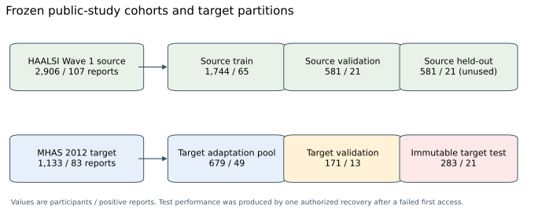

The flow displays people and positive reports in six fixed roles: HAALSI source fitting/validation/held-out and MHAS adaptation/validation/test. The analytic source has 2,906 people; the target has 1,133. Every target model is evaluated on the same 283 held-out people with 21 positive reports. The primary draw uses 25 positive and 75 negative adaptation labels; the 171 validation labels are additional. Repeated draws do not multiply the test population. See [endpoint and exclusions](phase1/dataset-and-endpoint.md).

## 2. Five clinical views and selective transfer

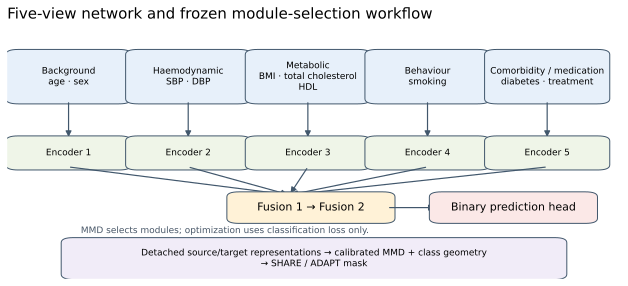

This is a **method schematic**, not measured clinical performance. Five 16-unit encoders represent background, haemodynamic, metabolic, behaviour and comorbidity/medication views. Two fusion modules and a binary head complete the 8,033-parameter clinical-width network. Detached MMD and signed source-relative class geometry decide which of seven internal modules may update. Invalid geometry abstains to SHARE; the 33-parameter head stays trainable. Freezing a view does not establish its medical irrelevance. [Actual equations and policy distinctions](phase1/model-architecture.md) explain why MMD is a selector statistic, not an added loss.

## 3. Development validation AP

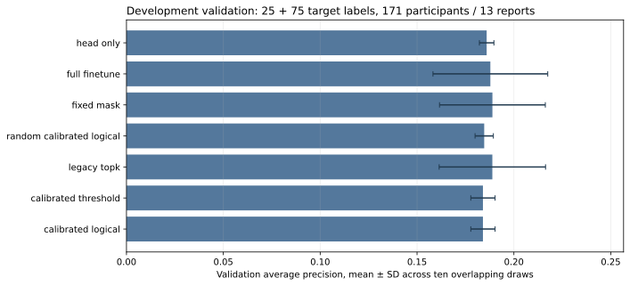

The x-axis is validation AP; method summaries describe the primary adaptation budget. Whiskers are **sample SD across fitted draws**, not independent-test confidence intervals. The same 171 MHAS validation participants, including 13 positive reports, also governed early stopping. This is development evidence, not a fresh validation cohort or an assessment of source held-out performance. The original source held-out scalar/curve is not invented to fill that gap. Validation and test observations differ, so their scores are not paired subject-level contrasts.

## 4. Frozen held-out average precision

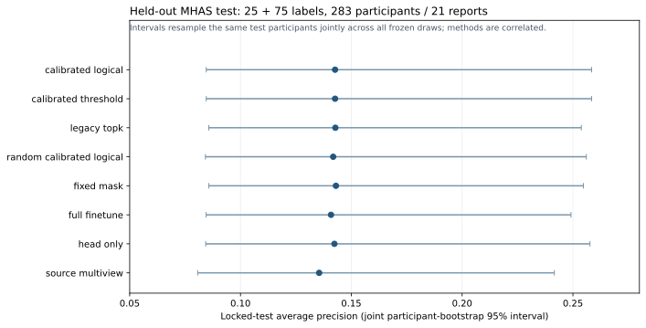

The horizontal scale is AP on one shared target test. Adapted methods average ten paired fits; source-only methods use one checkpoint. Whiskers are separate descriptive 95% joint participant-bootstrap intervals. AP is not accuracy, and apparent method ordering is not evidence of superiority. The registered logical mean AP is **0.142664**, versus **0.140845** for full fine-tuning. Read all 13 methods in the [primary and secondary tables](phase1/baselines-and-results.md), including unfavorable controls.

## 5. The registered paired AP comparison

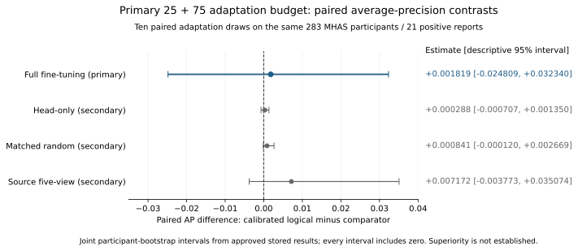

Dots are calibrated-logical-minus-comparator AP differences. The blue full-fine-tuning comparison is prespecified primary; gray rows are secondary comparisons. Horizontal intervals use the same joint participant-bootstrap pairing across methods and draws, with 2,000 replicates. The primary estimate is **+0.001819**, interval **[−0.024809,+0.032340]**. Every displayed interval includes zero: **superiority was not established**. This is the relevant paired estimand; overlap of two separate model intervals is a different object. [Replotting](phase1/reproducibility.md) reads stored public estimates and does not rerun the bootstrap.

## 6. All 13 methods: AUROC

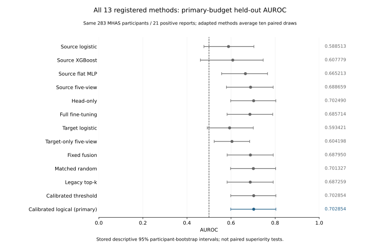

The horizontal scale is AUROC, with a dashed 0.5 reference; the right column gives each stored point estimate. Error bars are separate descriptive 95% participant-bootstrap intervals, **not paired superiority tests**. The primary calibrated-logical AUROC is **0.702854**. AUROC measures ranking across cutoffs; it does not establish sensitivity at 0.50, probability calibration or clinical utility. Source-only models have one checkpoint, while adapted rows average correlated fits. This new rendering uses the same approved records as the earlier public report-audit artwork.

## 7. Parameter economy

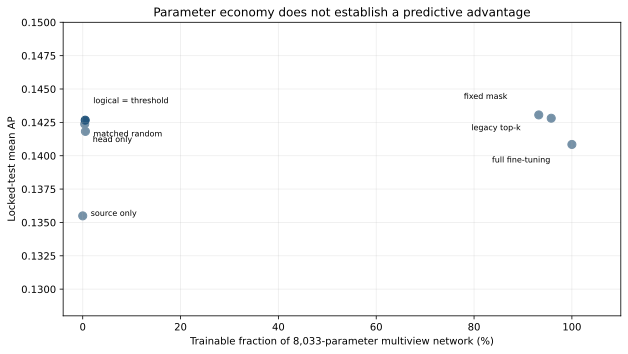

The axes compare trainable parameter fraction with test AP. Primary calibrated-logical adaptation updates a mean 41 of 8,033 parameters, approximately 0.51%, including the always-trainable head. Head-only is competitive, and lower parameter count does not establish predictive superiority or a measured runtime speedup. Fusion layers dominate the large-mask counts. See [parameter table and control degeneracy](phase1/baselines-and-results.md).

## 8. Module-selection behavior

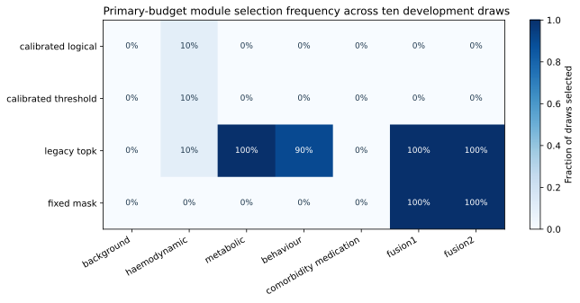

Cells show the frequency of ADAPT decisions over ten fitted draws for each module/policy. Calibrated logical selects no internal module in nine of ten primary draws; those fits effectively use head-only adaptation. Parameter-matched random masks coincide with logical in nine primary draws, limiting their ability to isolate selector value. The heatmap is **not a feature-importance map**. Its original SVG includes embedded raster heatmap/colorbar elements; this update preserves their original bytes.

## 9. Primary versus secondary label budgets

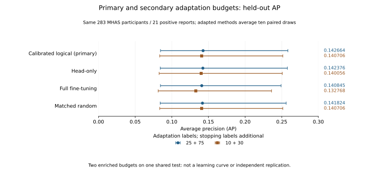

The horizontal scale is held-out AP. Blue circles use 25 positive +75 negative adaptation labels; brown squares use 10+30. Whiskers are separate descriptive 95% participant-bootstrap intervals. Both sets share the same held-out participants, and the smaller draws are nested. They are **two enriched budgets, not an outcome-blind learning curve or independent replication**; stopping labels remain additional. The secondary logical AP is **0.140706**, versus full fine-tuning **0.132768**. Its paired interval also includes zero. No budget or method is selected from this test plot.

## 10. Threshold methods and operating-point behavior

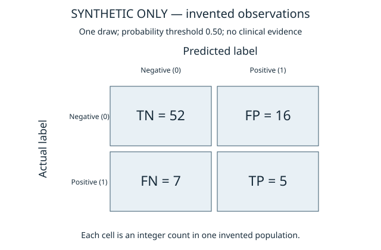

**Synthetic illustration only.** This image demonstrates matrix orientation and undefined precision using invented observations. It must not be cited as MHAS evidence. The [public example](../examples/threshold_demo.py) generates its own data and accepts no clinical input. The grid is fixed at 0.05–0.50; changing a binary cutoff leaves AP, AUROC and Brier unchanged for fixed scores.

Real confusion matrices, selected-threshold metric plots and ten-draw threshold-response figures exist according to independent operator reports but remain [publication-gated](phase1/threshold-publication-status.md). A completed integrity check does not clear small cells or cross-threshold differencing. Draw-0 matrices and ten-model descriptive means are different summaries; sample SD across fits is not a clinical confidence interval. `ORIGINAL_VALIDATION_OPTIMAL_THRESHOLD_NOT_ESTABLISHED` remains explicit. No test-optimal cutoff is published.

## 11. Execution history and limitations

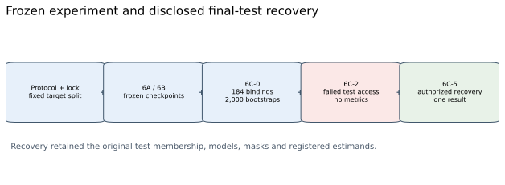

The timeline records a failed first final-test attempt and separately authorized recovery on the same frozen test, rather than an untouched first execution. It is an audit schematic, not a performance plot. See [frozen execution account](PHASE1_METHOD_AND_REPRODUCIBILITY.md).

Only 13 validation and 21 test positive reports, overlapping draws, enriched adaptation prevalence, diagnosis/report differences and attrition constrain inference. Brier **0.067654** is a scoring-rule result, not proof of calibrated individual clinical risk. No authentic ROC/PR/calibration curves can be reconstructed from scalar metrics, and none is fabricated here. The original clinical runner and joint test-bootstrap executor are not distributed. [Implementation map](PHASE1_REPORT_TO_CODE_MAP.md) and [limitations](phase1/limitations.md) distinguish reproducible software mechanisms from unavailable clinical reconstruction.
