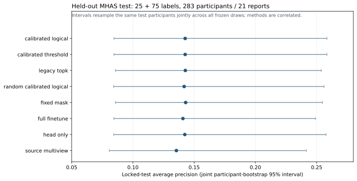
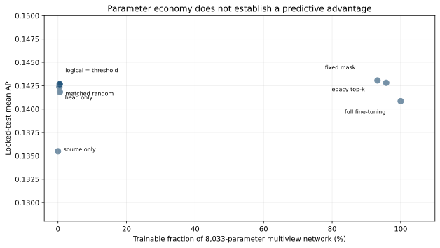

# Baselines and frozen results

[Phase 1 index](overview.md) · [Complete primary and secondary supplement](../SUPPLEMENTARY_AGGREGATE_RESULTS.md)

All numbers here come from the unchanged [approved aggregate JSON](../../results/aggregate_only_results.json) and frozen supplement. The primary 25+75 results below are arithmetic means over ten paired draws for adapted methods; four source-only models each have one checkpoint. All use the same 283-person test with 21 positive reports.

| Registered model identifier | AP | AUROC | Brier |
|---|---:|---:|---:|
| source_logistic | 0.094645 | 0.588513 | 0.069547 |
| source_xgboost | 0.130948 | 0.607779 | 0.069282 |
| source_flat_mlp | 0.117730 | 0.665213 | 0.069780 |
| source_multiview | 0.135493 | 0.688659 | 0.069207 |
| head_only | 0.142376 | 0.702490 | 0.067665 |
| full_finetune | 0.140845 | 0.685714 | 0.067472 |
| target_logistic | 0.146731 | 0.593421 | 0.110408 |
| target_multiview | 0.124333 | 0.604198 | 0.089143 |
| fixed_mask | 0.143058 | 0.687950 | 0.067467 |
| random_calibrated_logical | 0.141824 | 0.701327 | 0.067670 |
| legacy_topk | 0.142809 | 0.687259 | 0.067467 |
| calibrated_threshold | 0.142664 | 0.702854 | 0.067654 |
| calibrated_logical | 0.142664 | 0.702854 | 0.067654 |

The prespecified contrast is calibrated logical minus full fine-tuning: **+0.001819 AP**, descriptive 95% joint participant-bootstrap interval **−0.024809 to +0.032340**. The experiment did not demonstrate statistically established superiority. Individual-method error-bar overlap is not the registered paired comparison. Lower Brier is better. Numerical ranking of other descriptive rows does not authorize post-test model selection.

Source-only controls include logistic regression, XGBoost, flat MLP and the five-view network. Target-only controls use the target adaptation draw without source weights. Head-only isolates the classifier update; full fine-tuning updates all weights. Fixed fusion, parameter-matched random and legacy top-k contextualize the selective masks. The frozen supplement retains all 13 methods, intervals, secondary 10+30 results and comparisons, rather than discarding unfavorable methods.

## Parameter efficiency and control limitations

| Method | Primary mean trainable parameters | Fraction of 8,033 |
|---|---:|---:|
| Head-only | 33 | 0.41% |
| Full fine-tuning | 8,033 | 100% |
| Fixed fusion mask | 7,489 | 93.23% |
| Parameter-matched random | 44.2 | 0.55% |
| Legacy top-k | 7,693.8 | 95.78% |
| Calibrated threshold | 41 | 0.51% |
| Calibrated logical | 41 | 0.51% |

Fractions include the always-trainable head. Means can be fractional because masks differ by draw. Logical adapted no internal module in nine of ten draws at each budget; one primary draw adapted haemodynamic and one secondary draw fusion1. Random equalled logical in 9/10 primary and 10/10 secondary draws. The secondary logical-minus-random contrast was exactly zero because masks and trained states coincided; this is control degeneracy, not independent corroboration. Invalid geometry prompted abstention, not a medical claim that frozen views were unimportant.

## Development versus held-out evidence

Primary validation AP means for logical/full/head-only/random were 0.1840/0.1878/0.1859/0.1847 on 171 people with 13 positives. Validation also governed early stopping. The held-out means in the table refer to a different population and cannot be paired with validation scores as if they were the same observations. The secondary logical/full test AP means were 0.140706/0.132768 (rounded from the frozen JSON); see the supplement for the full results and uncertainty. No alternative timing or nine-feature final-test sensitivity is invented.

