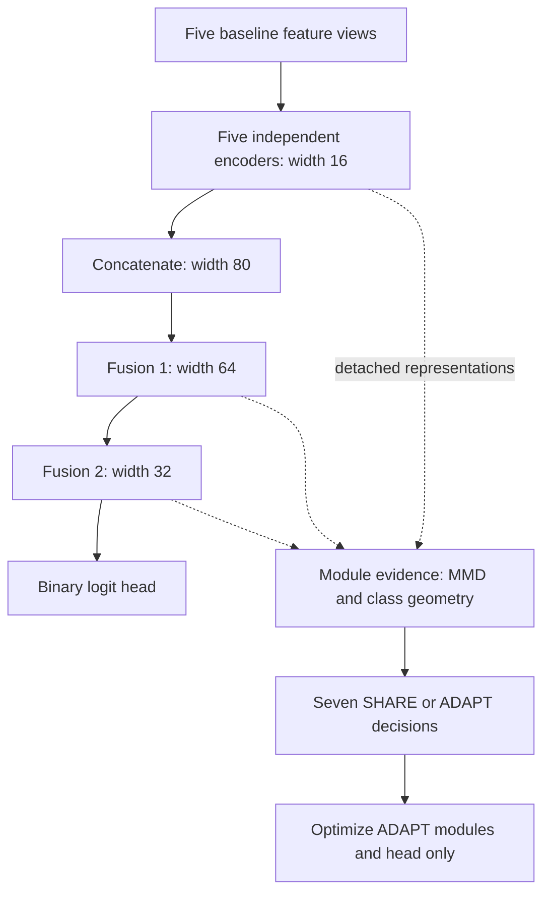

# Architecture and selective optimization

[Phase 1 index](overview.md) · [Original aggregate architecture figure](../../figures/02_architecture_selector.svg)

The actual network is implemented in [MultiViewRiskNet](../../src/dmv_mat_cvd/models/multiview_mlp.py). Each baseline view passes through Linear → ReLU → LayerNorm with output width 16. Five embeddings are concatenated into width 80, followed by fusion widths 64 and 32 and a linear binary-logit head. The clinical encoded inputs total 19 dimensions; the historical network has **8,033 parameters**, including a **33-parameter head**. Generic synthetic input dimensions can differ.



The five encoders and two fusion blocks are independently selectable modules. A SHARE block keeps its parameters frozen; its forward output can still change when an upstream ADAPT block changes. SHARE is not a claim of domain invariance. The head always updates during target adaptation. [set_selective_trainability and adapt_model](../../src/dmv_mat_cvd/transfer/adapt.py) clone the source model, freeze all parameters, enable masked modules and the head, and verify frozen state tensors after fitting. [train_model](../../src/dmv_mat_cvd/training.py) constructs AdamW only from parameters with `requires_grad=True`.

## Evidence mathematics

[Permutation MMD and relative geometry](../../src/dmv_mat_cvd/transfer/calibration.py) use detached source-validation and target-adaptation representations. For source vectors $s_i$ and target vectors $t_j$, biased squared MMD is

$$
\widehat{\mathrm{MMD}}^2=\frac{1}{n_s^2}\sum_{i,i'}k(s_i,s_{i'})+\frac{1}{n_t^2}\sum_{j,j'}k(t_j,t_{j'})-\frac{2}{n_sn_t}\sum_{i,j}k(s_i,t_j).
$$

The kernel averages Gaussian bandwidths 0.5, 1, 2 and 4 after pooled, label-blind RMS scaling. At most 128 observations per domain and 199 count-preserving permutations give $p=(1+\#\{M_b\geq M_{obs}\})/(199+1)$, with the code's numerical comparison tolerance. A degenerate null is explicit. This statistic **selects modules; it is never a differentiable alignment term in the BCE objective**.

Class geometry uses $D=\|\mu_1-\mu_0\|/r$, where $r$ is mean within-class Euclidean scatter, and signed retention $R=\cos(d_s,d_t)D_t/D_s$. A reversed direction can produce negative retention even with large target class separation. Bootstrap class-mean contrasts quantify retention uncertainty conditional on the fitted direction and plug-in radii; they are internal selector evidence, not clinical confidence intervals. Insufficient classes, weak or uncertain source geometry, and degenerate scatter are explicit validity states.

## Three distinct selectors

| Policy | Implemented rule |
|---|---|
| `legacy_topk` | Independently min-max-normalize MMD and target discriminability; rank $0.65M+0.35(1-D)$ and adapt four of seven modules in the frozen study. Public function exposes configurable fractions. |
| `calibrated_threshold` | With valid geometry, adapt if $R<0.5$ and upper retention $U<1$, or valid domain $p\leq0.05$, $R<0.8$ and $U<1$. |
| `calibrated_logical` | With valid geometry, adapt if $U<0.75$, or valid domain $p\leq0.05$, $R<0.8$ and $U<1$. This is the prespecified primary policy. |

Invalid geometry causes **ABSTAIN → SHARE**, including insufficient bootstrap support for source geometry. No rule reads target-test labels. Target-adaptation labels are used in class geometry; this is supervised adaptation. Random seeds control subsampling, permutations and bootstraps; seven decisions are recomputed for each registered adaptation draw. See [legacy and matched-random implementations](../../src/dmv_mat_cvd/transfer/selector.py), [scoring](../../src/dmv_mat_cvd/transfer/scores.py) and [role guards](../../src/dmv_mat_cvd/safeguards.py).

```text
pretrain on source training; select source checkpoint using source validation
for each stored paired target adaptation draw:
    extract detached source-validation and adaptation representations
    compute domain evidence and signed class retention for seven modules
    assign SHARE / ADAPT using the frozen selector; invalid evidence -> SHARE
    clone source weights; freeze SHARE modules; enable ADAPT modules and head
    fit on adaptation labels; choose checkpoint using target validation BCE
    freeze model and provenance before registered held-out evaluation
```

The [frozen manuscript](../FINAL_SUBMISSION_MANUSCRIPT.md) is authoritative for historical settings. The released generic implementation validates mechanisms synthetically; it does not contain the private real-cohort runner. The module-selection p criterion **0.05 is unrelated to a probability classification cutoff of 0.05**.
