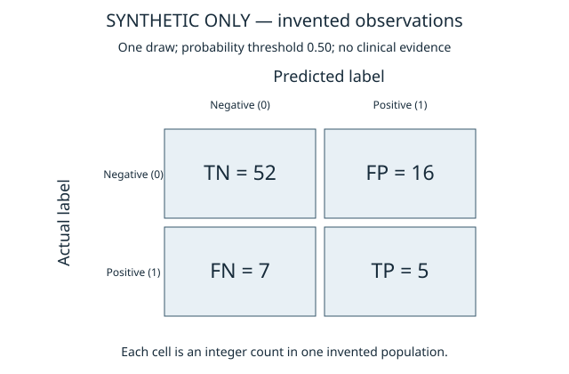

# Supplementary classification threshold analysis

[Phase 1 index](overview.md) · [Portable public implementation](../../src/dmv_mat_cvd/thresholds.py) · [Synthetic tests](../../tests/test_thresholds.py)

## Publication status

| Item | Status |
|---|---|
| Public threshold methodology and portable metrics software | Included in this repository |
| Public standalone analysis-package verification | 41 synthetic tests passed in this update |
| Original empirical threshold calculation | Completed independently; original aggregate outputs now inspected and validated |
| Source-output integrity | All 528 released aggregate files match their original recorded output hashes |
| Publication evidence basis | Researcher explicitly attested completed review/clearance and instructed publication; no separate documentary record or independent legal certification |
| Real published outputs | [510 matrices, 14 plot files, two CSVs, aggregate JSON and report](../../results/haalsi_mhas_real_threshold_analysis) |
| Original authenticated validation-optimal threshold | `ORIGINAL_VALIDATION_OPTIMAL_THRESHOLD_NOT_ESTABLISHED` |

The original standalone public source package generated an invented-data demonstration with 100 separate matrices. The portable GitHub demonstration uses a different, explicitly invented 80-observation fixture and ten draws. Neither is a clinical result. Original frozen AP/AUROC/Brier remain in the approved aggregate JSON; the real empirical outputs are published separately with their original identities.

## Fixed retrospective grid

The supplement examines **0.05, 0.10, 0.15, 0.20, 0.25, 0.30, 0.35, 0.40, 0.45 and 0.50** on unchanged retained probabilities. Predict positive iff $p_i\geq t$. No retraining, inference, score transformation, probability averaging or new test population is involved. Threshold 0.50 is a conventional reference, not an established optimal clinical rule for this imbalanced outcome. Lower thresholds trade false positives against false negatives; their clinical utility is not established by this table.

**A classification probability cutoff of 0.05 is unrelated to the selector's statistical criterion $p\leq0.05$.** The former converts a person's score into a predicted class; the latter calibrates an internal module-domain comparison.

## Metrics and undefined values

Rows of a confusion matrix are **actual** class; columns are **predicted** class:

| | Predicted negative | Predicted positive |
|---|---:|---:|
| Actual negative | TN | FP |
| Actual positive | FN | TP |

With $N=TP+TN+FP+FN$:

| Metric | Definition |
|---|---|
| Accuracy | $(TP+TN)/N$ |
| Precision (positive predictive value) | $TP/(TP+FP)$ |
| Recall / sensitivity | $TP/(TP+FN)$ |
| Specificity | $TN/(TN+FP)$ |
| F1 | $2TP/(2TP+FP+FN)$ |
| Balanced accuracy | $(\mathrm{recall}+\mathrm{specificity})/2$ |
| AUROC | Rank probability that a positive outscores a negative, with half credit for ties |
| Average precision | $\sum_k(R_k-R_{k-1})P_k$, over distinct ranked score cutoffs |
| Brier score | $N^{-1}\sum_i(p_i-y_i)^2$ |

Undefined ratios are `None`/N/A, never silently converted to strong performance. With actual positives but no predicted positives, precision is undefined, recall is zero and F1 is zero. If no positive class exists, AP and recall are unavailable under this implementation; AUROC requires both classes. AP is not accuracy, fixed-cutoff precision, or trapezoidal area under the ten displayed threshold points. Changing only the cutoff cannot change AP, AUROC or Brier.

## Reconciliation and repeated draws

The original independent analysis verifies 283 distinct participants, 21 positive/262 negative labels, exact score/ID ordering, checkpoint and registration provenance, and ten paired adapted draws before reporting. Source-only has its single original vector. Per-draw AP/AUROC/Brier **and their arithmetic means** must match frozen full-precision references with both absolute and relative tolerances 1e−8; mismatches stop the analysis rather than trigger inference or transformations.

Every draw receives its own integer confusion matrix at every cutoff. Summaries are means, sample SD (ddof=1), range and defined/undefined counts of per-draw metrics. They do not pool draws into an apparent 2,830-person cohort. Fractional mean counts are descriptive averages, not one realized confusion matrix. Across-draw SD is not an independent-test standard error or confidence interval.

## Threshold selection boundary

This is **supplementary descriptive analysis of an already examined frozen test**. Selecting its highest F1 and claiming an independently validated or clinically optimal threshold would be invalid. The grid does not choose a winner.

Authentic original validation scores, if ever independently established, must have original checkpoint provenance and disjoint validation/test membership. Only then may a validation-only rule maximize F1, breaking ties toward the highest threshold, before examining test scores. Original validation predictions are not established as available; this repository does not construct them or rerun inference. With 13 validation positives such a threshold would remain unstable, and F1 evaluated on its own selection labels would be optimistic resubstitution. Even its later test application would be a supplementary post-hoc analysis, not fresh confirmatory testing.

## Public reproduction and release boundary

The [portable API](../../src/dmv_mat_cvd/thresholds.py) reproduces arithmetic, reconciliation and descriptive draw aggregation. It takes arrays already aligned by a caller; it **does not authenticate membership, provide a clinical file reader, authorize protected processing, or replace the independent executor**. The latter and its controlled-data provenance checks remain separate and unchanged. Private source/checkpoint fingerprints and operational records were deliberately excluded from this GitHub integration.

Run the [synthetic-only example](../../examples/threshold_demo.py) as documented in [reproducibility](reproducibility.md). The committed figure below contains only invented data. Public tests do not reproduce real threshold findings from unavailable participant scores.

The [real empirical release](../../results/haalsi_mhas_real_threshold_analysis) records the subsequent researcher-attested review covering this collection, including small-cell/differencing and public GitHub scope. Completion and hashes did not themselves grant permission. The source-generation PRIVATE labels remain unchanged, and the release does not assert independent legal/institutional approval. Participant-level inputs/predictions, checkpoints and operational records remain excluded.
