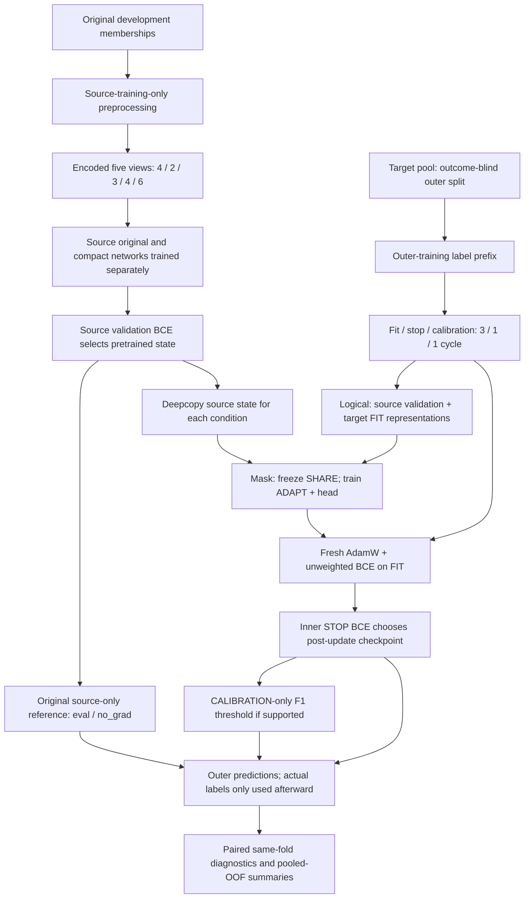

# Negative-transfer mechanisms

Real negative transfer is not independently established by this audit. The prompt describes exploratory development patterns; protected predictions and reports were not accessed. A credible comparison requires source and adapted scores on identical held-out participants, a defined aggregation/metric, and uncertainty appropriate to participant reuse and prior architecture selection.

## Reconstructed training flow

Source learning is unweighted binary cross-entropy, AdamW LR .001, decay .0001, batch 64, maximum 30 epochs, patience five, validation-BCE min-delta 1e-5. These development workflows train a source initialization using their development inputs; they do not load the historical final-test checkpoint. Original architecture has 8,033 parameters; compact has 2,225 and its own source pretraining. Target adaptation uses fresh AdamW, LR .001, max 20 epochs and the same BCE/decay/batch/patience. Head-only changes 33 parameters; full changes all; logical changes head plus selected blocks. No target optimizer momentum is inherited from source training.

Preprocessing is source-training-fitted: continuous median imputation and standardization, categorical one-hot with explicit unknown categories. The export fits once on source training and transforms all development roles. Follow-up reuses those arrays; it does not refit target normalization. LayerNorm is inside each network, with learned affine weights controlled by the same mask, and no BatchNorm running state. The shared preprocessing includes a nonclinical encoding contract; our Gaussian stress fixtures model generic encoded numeric features and do not attempt to reproduce clinical category distributions.

The four compared neural methods use identical unweighted BCE. Weighted BCE, focal and source-shrinkage branches exist in the old candidate factory but are not enabled in the four-method follow-up. The original seven includes target-only logistic regression and two target-LR variants; these are not part of the later four-method comparison.

## Mechanism matrix

Each proposed restricted-data diagnostic below is a *future*, separately authorized operation, not something executed here. Existing completed runs/markers must remain immutable.

| Mechanism | Supporting/contradicting code evidence | What remains unknown | Synthetic exposure and falsifiable diagnostic |
|---|---|---|---|
| LR too aggressive for target data | .001 used for both source and target despite smaller target fitting sets; no layer-specific LR | Actual loss surface, gradients and best LR | Tiny/aligned fixtures lose AP under full adaptation. Future matched .001 vs .0001, same architecture/roles/seed; inspect paired AP/Brier and drift |
| Harmful source forgetting | Full updates all 8,033; no anchor in active four methods; source epoch zero excluded | Whether real useful source separation is lost | Measure layer drift and source-validation change alongside target effect; reversal fixture shows source loss can be necessary for target gain |
| Scarce target events | Outcome-blind prefixes; no redraw; BCE allows single-class fit | Real per-fold event allocation | Invented zero-positive fit loses AP. Future support-stratified descriptive audit without changing memberships |
| Covariate shift | Source scaler fixed; target representations may differ; MMD tests representations | Actual magnitude/direction and causal impact | Translated class-conditional features demonstrate score/calibration effects; future standardized feature/representation discrepancies locally |
| Prevalence / endpoint shift | Older draws enforce 25/75; later prefixes not enriched; source/target report endpoints inherited | True label-shift assumptions or measurement-error differences | Pure-prior-shift fixture improves Brier while reducing AP; future distinct prior/measurement audits, no relabeling |
| Optimizer/normalization mismatch | Fresh AdamW, same loss/decay; no inherited momentum; fixed source preprocessing; LayerNorm only | Numerical runtime differences if a private run differs from public contract | Optimizer-ID and unchanged-input tests contradict accidental target normalization; compare exact runtime bindings locally only |
| Class-weight instability | **Contradicted for these four methods**: BCE has no positive weight | Other unexecuted candidates cannot explain these runs | Weighted-loss denominator is irrelevant here; do not claim zero-positive weighted-loss failure caused current results |
| Too many free parameters | Fusion1 5,312; all internal blocks may adapt; compact still 2,225 | Whether actual representation complexity exceeds useful sample information | Exact-mask tests plus tiny fitting scenario; future fixed architecture/mask comparison separates complexity from source initialization |
| Noisy stopping / objective mismatch | STOP BCE, not AP; tiny random stop sets; epoch zero never competes | Actual epoch curves/support/private metric conflict | Synthetic AP drop with better Brier; zero-positive stopping; source-inclusive stopping counterexample |
| Different source-only vs adapted scoring | Same outer rows, frozen inputs and sigmoid helper; source-only common model, adapted fold-specific models | Actual score offset across folds | Pooled-OOF counterexample lowers AP without within-fold rank loss; future same-fold source paired differences plus pooled diagnostics |

## What synthetic evidence shows

The prespecified neural plan used six scenarios, three seeds and four target methods. Invented Gaussian class-conditional means define source prevalence .20; targets vary translation, relationship direction, prevalence and fit/stop sizes. Source means/scales are fitted only on invented source training. No seed was chosen for a favorable result; all conditions remain in the JSON.

The translated-feature scenario is a moderate marginal feature-distribution shift. Translating both class-conditional feature distributions also translates the posterior decision function; it is **not** a pure covariate-shift construction that holds P(Y|X) fixed. The pure-prior-shift scenario instead holds P(X|Y) fixed and changes P(Y). These distinctions limit which mechanisms each synthetic comparison isolates.

- Aligned full adaptation mean AP change against its own source initialization: −0.00836; head/logical +0.00368. A good source model need not benefit from target updates.
- Relationship reversal: full +0.38729 and logical +0.38791 AP; head-only +0.00018. Frozen encoders can prevent recovery when the relevant representation relationship changes.
- Scarce positives: all three invented fitting sets happened to have zero positives under the fixed plan. Full AP change −0.12434, Brier change −0.02396. Lower Brier is compatible with worse event ranking when negatives dominate.
- Pure prior shift: full AP −0.01800, Brier −0.01490. There is no single scalar notion of better performance across metrics.
- Tiny aligned fitting: full AP −0.03478, head/logical +0.00110. Full model drift can be harmful with very little fitting evidence.

These are controlled mechanism demonstrations, **not estimates of any HAALSI/MHAS effect**. Three synthetic seeds do not support clinical uncertainty claims. Compact deltas in the detailed results use compact's own source reference to avoid attributing its independently trained architecture difference solely to adaptation.

In reversal, full adaptation reduced synthetic source-validation AP by about .652 while improving target AP; calling all source forgetting harmful would be wrong. Relative drift and gradient norms are measured, but are not direct measures of retained clinical utility. MMD significance and class geometry are selection inputs, not evidence that an adapted model will improve.

## Pooled OOF diagnostic

For labels [1,0] in each of two folds, shared source scores [.6,.4] in both give pooled AP/AUROC 1/1. Adapted fold scores [.9,.8] and [.2,.1] each rank perfectly, yet pooled AP=5/6 and AUROC=.75. Pooled evaluation is a valid specified summary of the combined predictions, but is sensitive to cross-model score comparability. Report both same-fold differences and pooled metrics in a future diagnostic. Existing paired summaries compare against matched_control, not source_only_zero; separately reading their means is not a paired source-retention analysis.
