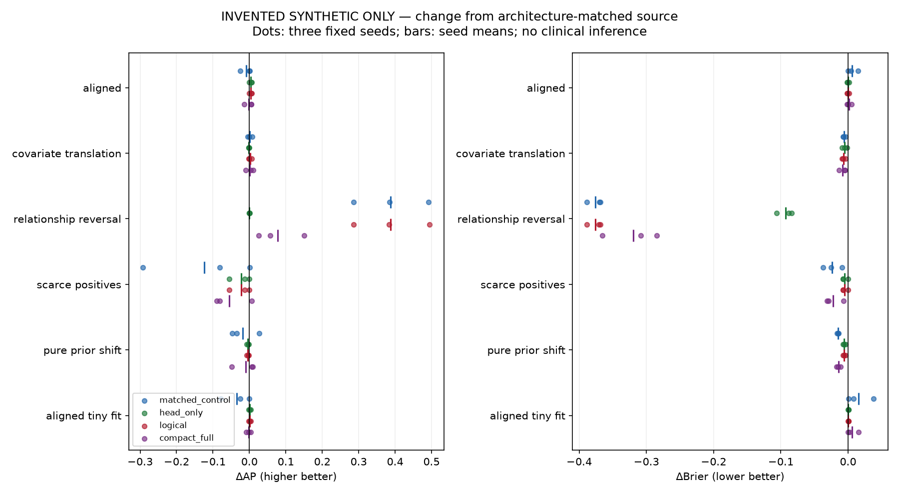

# Synthetic diagnostic evidence

**INVENTED DATA ONLY. No result in this file estimates HAALSI/MHAS performance.**

Plan frozen in SYNTHETIC_PLAN.json before fitting: seeds101/202/303; six scenarios; source1,536/validation384; target evaluation1,536 per scenario/seed. Source prevalence .20. Source preprocessing fit only on invented source training. Standard and compact source networks were trained separately, max30 epochs; target max20, .001 LR, BCE, patience5. Selector uses19 permutations/39 bootstraps to keep this a mechanism demonstration; these reduced counts are not the real experiment's199/199.

Six source fits, 72 target fits and36 source-reference evaluations; all planned conditions retained. Neural diagnostic elapsed time 3.263s on this runtime; not a clinical-run compute estimate.

## Mean changes from the architecture-matched source reference

Lower Brier is better; higher AP/AUROC is better. These are means over three fixed synthetic seeds, without claims of statistical significance or clinical precision. Compact comparisons use the compact source reference; other methods use original source. Full raw synthetic traces, class support, layer drift and gradient norms are retained in synthetic_results/NEURAL_MECHANISMS.json.

| Scenario | Method | ΔAP | ΔAUROC | ΔBrier | Updated parameters by seed |
|---|---|---:|---:|---:|---|
| aligned | matched_control | -0.00836 | -0.00383 | +0.00631 | 8033, 8033, 8033 |
| aligned | head_only | +0.00368 | +0.00143 | -0.00008 | 33, 33, 33 |
| aligned | logical | +0.00368 | +0.00143 | -0.00008 | 33, 33, 33 |
| aligned | compact_full | -0.00163 | -0.00242 | +0.00130 | 2225, 2225, 2225 |
| covariate_translation | matched_control | +0.00068 | -0.00012 | -0.00578 | 8033, 8033, 8033 |
| covariate_translation | head_only | -0.00135 | +0.00046 | -0.00531 | 33, 33, 33 |
| covariate_translation | logical | +0.00160 | +0.00063 | -0.00646 | 33, 7697, 7697 |
| covariate_translation | compact_full | +0.00147 | -0.00037 | -0.00790 | 2225, 2225, 2225 |
| relationship_reversal | matched_control | +0.38729 | +0.69869 | -0.37565 | 8033, 8033, 8033 |
| relationship_reversal | head_only | +0.00018 | +0.00181 | -0.09285 | 33, 33, 33 |
| relationship_reversal | logical | +0.38791 | +0.70128 | -0.37577 | 7921, 7921, 7921 |
| relationship_reversal | compact_full | +0.07766 | +0.33764 | -0.31958 | 2225, 2225, 2225 |
| scarce_positives | matched_control | -0.12434 | -0.07292 | -0.02396 | 8033, 8033, 8033 |
| scarce_positives | head_only | -0.02267 | -0.00057 | -0.00485 | 33, 33, 33 |
| scarce_positives | logical | -0.02267 | -0.00057 | -0.00485 | 33, 33, 33 |
| scarce_positives | compact_full | -0.05495 | -0.03766 | -0.02245 | 2225, 2225, 2225 |
| pure_prior_shift | matched_control | -0.01800 | -0.00720 | -0.01490 | 8033, 8033, 8033 |
| pure_prior_shift | head_only | -0.00396 | -0.00008 | -0.00591 | 33, 33, 33 |
| pure_prior_shift | logical | -0.00396 | -0.00008 | -0.00591 | 33, 33, 33 |
| pure_prior_shift | compact_full | -0.01051 | -0.01572 | -0.01431 | 2225, 2225, 2225 |
| aligned_tiny_fit | matched_control | -0.03478 | -0.01260 | +0.01572 | 8033, 8033, 8033 |
| aligned_tiny_fit | head_only | +0.00110 | +0.00060 | +0.00034 | 33, 33, 33 |
| aligned_tiny_fit | logical | +0.00110 | +0.00060 | +0.00034 | 33, 33, 33 |
| aligned_tiny_fit | compact_full | -0.00200 | -0.00178 | +0.00594 | 2225, 2225, 2225 |

## Test coverage

30 unittest test methods passed, zero failures (test log in TEST_RESULTS.txt). Exhaustive 128-mask checks and3,054 scalar reference decisions are assertions within these methods, not 3,182 independent experiments. Additional tests cover NumPy geometry/MMD reference agreement, seed determinism, copied source isolation, outer/calibration-label flipping, role overlap rejection, supported-subset reporting, constant/skewed/tied scores, zero/one stopping events, calibration support0/1/4/5/6, missing class metrics and epoch-zero/pooled-OOF counterexamples.

Every neural target fit checked exact optimizer IDs, immutable cached source state and shared module equality. All initial/final public snapshot hashes agree. These checks do not prove private run provenance or general statistical feasibility.

## Additional deterministic evidence

- EPOCH_ZERO_COUNTEREXAMPLE.json: source BCE .12692806 versus selected .13055249; epoch1 wins because initial loss is not a candidate.
- POOLED_OOF_COUNTEREXAMPLE.json: both folds have AUROC/AP1, but adapted pooled AUROC.75/AP.833333 due to cross-fold score offsets.
- THRESHOLD_STRESS.json:100 resamples,99 supported; threshold .04381–.37368, separate invented evaluation recall .03–.94. No unsupported resample was replaced.
- DESIGN_ARITHMETIC.json: exact role sizes and hypergeometric support probabilities derived from public historical pool totals. Not observed private support counts.
- ENVIRONMENT.json: actual package/runtime versions.

## Reproduction and preservation

See README.md for the focused tests and exclusive-output synthetic command. The original follow-up and seven-candidate trainer/metric files match byte-for-byte; SOURCE_INTEGRITY.json checks their registered public pins and records public SHA256 values. AUDIT_SHA256.json binds all new report, code, test, plot and synthetic output files; it excludes itself. No real-input execution interface or clinical recovery controller was added.

The plot shows each synthetic seed; its variability is not a clinical confidence interval.
