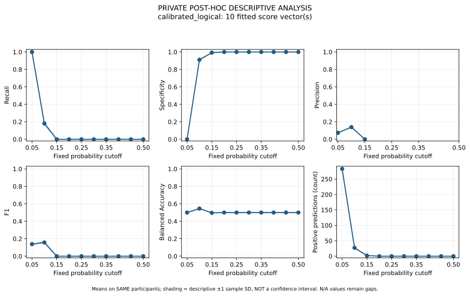

# Real HAALSI → MHAS retained-score threshold results

**Empirical results, not synthetic examples.** This release preserves the completed original supplementary analysis: 510 confusion matrices, six model-specific response figures (SVG/PNG), one cross-method comparison (SVG/PNG), two metric CSVs, the full aggregate JSON and the original report. All 528 original files match their entries in the original result-integrity manifest. No model was trained, no inference rerun and no score changed for publication.

## Release basis and original labels

The researcher explicitly stated in the publication conversation that the independent review was completed, clearance had been obtained, and publication should proceed. This scope covers AI-assisted aggregate inspection and public GitHub distribution. **No separate documentary clearance record was supplied; Codex does not claim independent legal/institutional certification.** The [release manifest](RELEASE_MANIFEST.json) records that evidence basis transparently; it is not a fabricated authorization receipt or reviewer signature.

Original SVG/PNG titles and report text still contain their historical `PRIVATE POST-HOC DESCRIPTIVE ANALYSIS` / `DISCLOSURE NOT CLEARED` wording from generation. Those original bytes were retained. This release README records the subsequent researcher-attested permission; no protection marker was deleted to manufacture approval. No participant-level inputs/predictions, identifiers, fitted checkpoints, private configuration, authorization, provenance or runtime records are published.

## Browse every authentic family

| Model | Score vectors | Confusion SVGs | Original response plots |
|---|---:|---:|---|
| calibrated_logical, primary | 10 | [100 matrices](confusion_matrices/calibrated_logical) | [SVG](summary_plots/calibrated_logical_threshold_response.svg), [PNG](summary_plots/calibrated_logical_threshold_response.png) |
| full_finetune | 10 | [100 matrices](confusion_matrices/full_finetune) | [SVG](summary_plots/full_finetune_threshold_response.svg), [PNG](summary_plots/full_finetune_threshold_response.png) |
| head_only | 10 | [100 matrices](confusion_matrices/head_only) | [SVG](summary_plots/head_only_threshold_response.svg), [PNG](summary_plots/head_only_threshold_response.png) |
| random_calibrated_logical | 10 | [100 matrices](confusion_matrices/random_calibrated_logical) | [SVG](summary_plots/random_calibrated_logical_threshold_response.svg), [PNG](summary_plots/random_calibrated_logical_threshold_response.png) |
| source_multiview | 1 | [10 matrices](confusion_matrices/source_multiview) | [SVG](summary_plots/source_multiview_threshold_response.svg), [PNG](summary_plots/source_multiview_threshold_response.png) |
| target_logistic | 10 | [100 matrices](confusion_matrices/target_logistic) | [SVG](summary_plots/target_logistic_threshold_response.svg), [PNG](summary_plots/target_logistic_threshold_response.png) |

Every adapted-model folder contains draws 0–9 at fixed cutoffs 0.05, 0.10, …, 0.50. The source-only filenames use `draw_source`, preserving the original singleton identity. A filename is `draw_<draw>__fixed_<cutoff>.svg`; all rows are actual negative/positive and columns predicted negative/positive.

Primary model, **draw 0**: [0.05](confusion_matrices/calibrated_logical/draw_0__fixed_0.05.svg) · [0.10](confusion_matrices/calibrated_logical/draw_0__fixed_0.10.svg) · [0.50](confusion_matrices/calibrated_logical/draw_0__fixed_0.50.svg).



Each response figure shows descriptive mean recall, specificity, precision, F1, balanced accuracy and positive-prediction count. Shading is ±1 sample SD across fitted models, **not a confidence interval**. Undefined precision remains a gap. The source-only figure has one score vector and no estimable across-draw SD. The [cross-method SVG](summary_plots/method_comparison.svg) / [PNG](summary_plots/method_comparison.png) compares all six families at every displayed cutoff without selecting a winner.

## Original numerical outputs

- [Per-draw metrics](threshold_metrics_per_draw.csv): 510 original rows, integer TP/TN/FP/FN and threshold metrics, with AP/AUROC/Brier unchanged across cutoffs.
- [Descriptive summaries](threshold_metrics_summary.csv): 1,140 rows, defined/undefined counts, means, sample SD and ranges across fitted models.
- [Full aggregate JSON](threshold_sweep.json): exact original counts, extended metrics, draw identities, summaries and ranking reconciliation.
- [Original comparison report](THRESHOLD_COMPARISON.md): retained verbatim, including its original generation-time privacy warning and private filename references. The two public CSV copies were renamed only; their bytes are unchanged.

## Scientific interpretation

These are **retrospective descriptive operating points on an already examined frozen test**, not independently selected or clinically validated thresholds. Ten adapted score vectors reuse the same 283 participants, including 21 positive reports and 262 negatives. They are not independent cohorts or 2,830 test people. Mean fractional counts are never a realized confusion matrix.

For primary draw 0, 0.50 gives TP/TN/FP/FN = 0/262/0/21; 0.10 gives 4/238/24/17; 0.05 gives 21/0/262/0. Precision is undefined with zero positive predictions. The lowest cutoff detects every positive report while also predicting every negative positive. None of these points is established as a clinical optimum. A 0.05 probability cutoff is unrelated to the selector's statistical p-value criterion.

`ORIGINAL_VALIDATION_OPTIMAL_THRESHOLD_NOT_ESTABLISHED` remains the actual status. No original validation probabilities were reconstructed. Changing a cutoff does not change AP, AUROC or Brier. Primary ten-draw mean AP 0.142664 / AUROC 0.702854 / Brier 0.067654 and the inconclusive logical-minus-full AP comparison remain unchanged. These ten-draw means must not be replaced by draw-0 results.

## Verification and exclusions

[Validation results](VALIDATION_REPORT.json) record all matrix cells/identities, independent count arithmetic, all descriptive summaries, ranking reconciliation and vector-plot mean-point checks. Run from the repository root:

```sh
python scripts/validate_real_threshold_release.py
```

The validator reads **only released aggregate files and previously public references**. It never opens clinical arrays, IDs, checkpoints or private operations. Hash equality binds published copies to the original recorded output; it is not publisher authentication and does not recompute ranking metrics from raw scores.

Seven source-directory files remain excluded: private provenance/integrity/runtime records and two system metadata files. The exact relative filenames/reasons are in the release manifest. No checkpoints or configuration files exist inside this reviewed output directory; no external private directories were followed. Academic B.Tech documents and LaTeX remain excluded by instruction.

## Additional preserved aggregate dashboard

[Download the offline threshold explorer](threshold_animation.html) and open locally in a browser. Its original private title is preserved. This is an existing **post-run derivative**, not one of the original integrity-manifest entries: its creation executor was not established. All 510 embedded aggregate rows independently match the original metric CSV; there are no participant scores/IDs, external dependencies or network requests. Its new hash is recorded separately from the 528 original integrity-bound outputs. It does not compute new model predictions or select a validated optimum. Connecting lines are visual guides across the fixed grid, not measurements at intermediate cutoffs.
